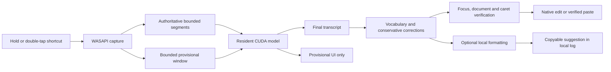

# Architecture — 0.5.0

The CustomTkinter Windows GUI owns settings, local history and status. A separate background process owns Windows hooks, microphone capture, ASR and guarded insertion. A Windows Job Object ties the worker tree to the GUI. Inference never runs on Tk's event thread.

Final segmentation remains 8-second maximum windows with silence endpoints and limited forced-split overlap. Previews start at 0.8 seconds of buffered audio, repeat at bounded intervals over at most four seconds, and use one replaceable pending request. Real jobs have queue priority. Previews cannot change final text or enter external applications. One preview already executing on the GPU cannot be preempted; disabling previews is supported in settings data for controlled benchmarking.

Ctrl+Win uses the ordered low-level modifier dispatcher. Hold release stops capture and discards an in-flight post-release frame. A short first press pauses capture while the double-tap timer runs; the second locks recording, the next press stops it. The basic dispatcher and timing model remain intact.

Meaning preservation uses an ordered semantic token sequence, protected literals, names, numbers and qualifiers. The local deterministic correction pass changes only explicit bounded values or known vocabulary alternatives. This is deliberately narrower than unrestricted language-model rewriting. Raw ASR remains available. The default AI path inserts deterministic text without waiting; optional delayed formatting is stored as a suggestion, never blindly backspaced into another app. An opt-in bounded wait remains available.

Insertion requires an unchanged target, collapsed selection and verified text. Native Edit/Rich Edit uses a target-owned undo transaction. Other supported controls use a temporary clipboard transaction or bounded Unicode events, with readback. No whole-field replacement or automatic focus recovery is used. Rich Edit UTF-16 paragraph offsets, Chromium final-paragraph sentinels and compatible legacy 4096-UTF-16-unit ValuePattern truncation have specific regression coverage. Documents and insertions remain bounded; unsafe or uncertain results are retained.

Settings are written atomically as user-bound Windows DPAPI envelopes. History payloads use the same protection; legacy plaintext rows migrate when opened by the new version. UI Home/Log pages reuse cached widgets. Inference is local-files-only; network access is limited to explicit model/runtime setup, configured loopback AI, and explicit/opt-in GitHub release metadata checks. See PRIVACY.md for the limits of these protections.
